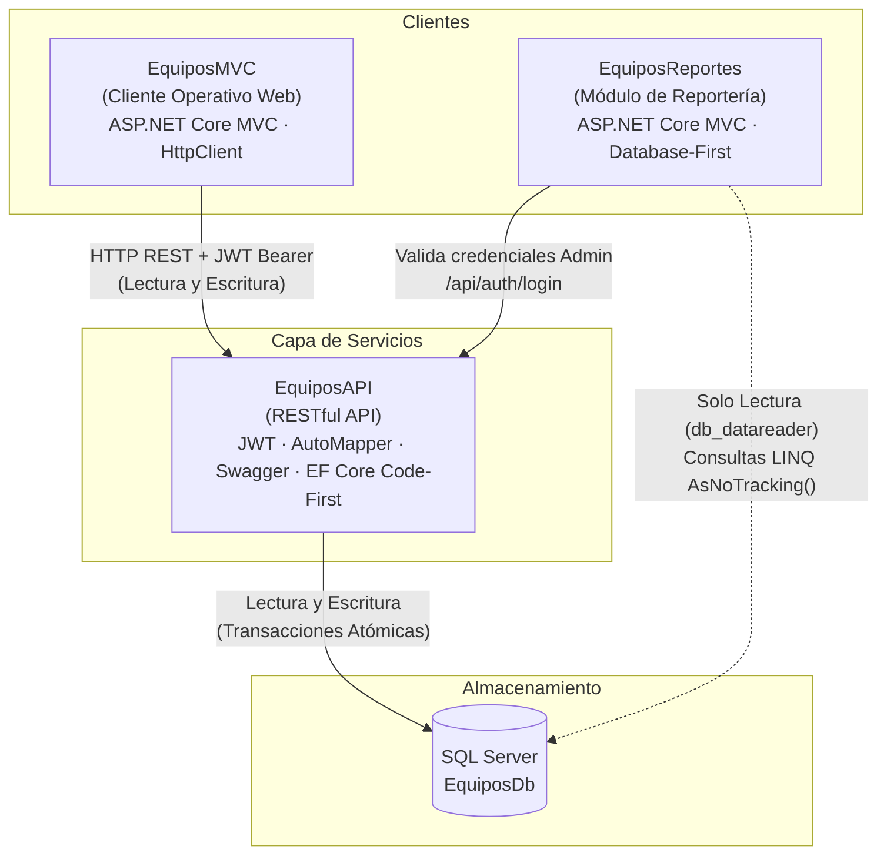

# Sistema Integral de Control y Préstamo de Equipos de Laboratorio
### Universidad Don Bosco (UDB) - Facultad de Estudios Tecnológicos
**Asignatura:** Programación de Servidores Web  
**Ciclo:** 2026  

---

## Integrantes del Equipo
* **Diego Cortez** — `DiegoCortez05` (`diegoluromero@gmail.com`)
* **Carmen Abigail Granados Carmona** — `GC262440` (`gc262440@udb.edu.sv`)

---

## I. Arquitectura de la Solución

El sistema se compone de tres proyectos modulares desacoplados que comparten una única base de datos SQL Server (`EquiposDb`):



### Restricciones de Arquitectura Cumplidas
1. **Separación de responsabilidades:** Toda escritura al sistema pasa obligatoriamente por `EquiposAPI`. `EquiposMVC` y `EquiposReportes` nunca realizan modificaciones directas en la base de datos.
2. **Acceso de solo lectura:** `EquiposReportes` consulta la base de datos con el contexto generado por `Scaffold-DbContext`, utilizando exclusivamente un usuario SQL con el rol `db_datareader`.
3. **Seguridad y Cero Credenciales en Código:** No existen contraseñas, cadenas de conexión ni claves JWT en `appsettings.json`, `Program.cs` ni repositorios. Todo reside en **User Secrets** de .NET.

---

## II. Requisitos de Software

* **SDK .NET:** 10.0 (o compatible)
* **Gestor de Base de Datos:** Microsoft SQL Server 2019 / 2022 / 2025 (LocalDB, Express o Developer Edition)
* **Herramientas recomendadas:** SQL Server Management Studio (SSMS) o Azure Data Studio, Postman v10+.

---

## III. Configuración Inicial y User Secrets

Antes de iniciar, ejecute los siguientes comandos en PowerShell dentro de la carpeta de cada proyecto para registrar los secretos en su equipo local:

### 1. Configuración de `EquiposAPI`:
```powershell
cd EquiposAPI
dotnet user-secrets init
dotnet user-secrets set "ConnectionStrings:DefaultConnection" "Server=.;Database=EquiposDb;Trusted_Connection=True;MultipleActiveResultSets=true;TrustServerCertificate=True;"
dotnet user-secrets set "Jwt:Key" "SuperSecretJwtKeyParaPrestamoDeEquipos2026!#DefensaUDB"
dotnet user-secrets set "Jwt:Issuer" "EquiposAPI"
dotnet user-secrets set "Jwt:Audience" "EquiposClients"
dotnet user-secrets set "Jwt:ExpireMinutes" "120"
dotnet user-secrets set "AdminSeed:Username" "admin"
dotnet user-secrets set "AdminSeed:Email" "admin@udb.edu.sv"
dotnet user-secrets set "AdminSeed:Password" "Admin123*!Secure"
cd ..
```

### 2. Configuración de `EquiposMVC`:
```powershell
cd EquiposMVC
dotnet user-secrets init
dotnet user-secrets set "ApiBaseUrl" "http://localhost:5000"
cd ..
```

### 3. Configuración de `EquiposReportes`:
```powershell
cd EquiposReportes
dotnet user-secrets init
dotnet user-secrets set "ConnectionStrings:ReportesConnection" "Server=.;Database=EquiposDb;Trusted_Connection=True;MultipleActiveResultSets=true;TrustServerCertificate=True;"
dotnet user-secrets set "ApiBaseUrl" "http://localhost:5000"
cd ..
```

*(Opcional: Si desea ejecutar el usuario de SQL Server con clave en lugar de Trusted_Connection, ejecute el script `CrearUsuarioReportes.sql` en SSMS y configure `ReportesConnection` con `User Id=reportes;Password=ReportesPass123*!;`)*

---

## IV. Orden de Arranque y Ejecución

Abra tres pestañas o ventanas de terminal:

### Paso 1: Iniciar `EquiposAPI` (Puerto `http://localhost:5000`)
```powershell
cd EquiposAPI
dotnet run
```
* **Swagger UI:** `http://localhost:5000/` (disponible directamente en la raíz).
* Al arrancar por primera vez, `EquiposAPI` ejecuta automáticamente las migraciones pendientes y siembra el Administrador inicial y el catálogo de categorías y equipos de prueba.

### Paso 2: Iniciar `EquiposMVC` (Puerto `http://localhost:5100`)
```powershell
cd EquiposMVC
dotnet run
```
* **Acceso:** `http://localhost:5100`

### Paso 3: Iniciar `EquiposReportes` (Puerto `http://localhost:5200`)
```powershell
cd EquiposReportes
dotnet run
```
* **Acceso:** `http://localhost:5200` (exige login de Admin).

---

## V. Usuarios Semilla Preconfigurados

| Rol | Nombre de Usuario | Contraseña | Permisos |
| :--- | :--- | :--- | :--- |
| **Admin** | `admin` | `Admin123*!Secure` | CRUD total de categorías y equipos, registrar usuarios, préstamos, devoluciones y reportes. |
| **Docente** | `docente1` | `Docente123*` | Prestar equipos, registrar devoluciones, ver todos los préstamos. |
| **Estudiante** | `estudiante1` | `Estudiante123*` | Ver únicamente equipos disponibles y consultar exclusivamente sus propios préstamos. |

---

## VI. Matriz de Verificación de los 12 Casos de Prueba

| Nº | Caso Verificado | Endpoint / Flujo | Resultado Esperado | Resultado Obtenido | Estado |
| :---: | :--- | :--- | :--- | :--- | :---: |
| **1** | Login correcto devuelve token con rol | `POST /api/auth/login` con credenciales válidas | `200 OK` con JSON conteniendo `token`, `username`, `email`, `rol` y `expiresAt` | Token JWT emitido con claims `nameid`, `unique_name`, `role` | ✅ Aprobado |
| **2** | Login con contraseña incorrecta devuelve 401 | `POST /api/auth/login` con password erróneo | `401 Unauthorized` | Devuelve `401 Unauthorized` con mensaje "Credenciales incorrectas" | ✅ Aprobado |
| **3** | Endpoint protegido sin token devuelve 401 | `GET /api/equipos` sin encabezado Authorization | `401 Unauthorized` | Middleware JWT rechaza la petición | ✅ Aprobado |
| **4** | Estudiante intenta crear un equipo y recibe 403 | `POST /api/equipos` con token de Estudiante | `403 Forbidden` | Bloqueado por `[Authorize(Roles = "Admin")]` | ✅ Aprobado |
| **5** | Registrar usuario con Username repetido devuelve 409 | `POST /api/auth/register` con username existente | `409 Conflict` | Mensaje: "El nombre de usuario '...' ya está registrado" | ✅ Aprobado |
| **6** | Prestar un equipo que ya está Prestado devuelve 409 | `POST /api/prestamos` sobre equipo con `Estado != "Disponible"` | `409 Conflict` | Mensaje: "No se puede prestar el equipo ... porque su estado actual es Prestado" | ✅ Aprobado |
| **7** | FechaVencimiento a 15 días es rechazada | `POST /api/prestamos` con `FechaVencimiento > hoy + 7 días` | `400 Bad Request` | Mensaje: "La fecha de vencimiento no puede ser superior a 7 días" | ✅ Aprobado |
| **8** | Eliminar equipo con historial devuelve 409 | `DELETE /api/equipos/{id}` con préstamos asociados | `409 Conflict` | Mensaje: "No es posible eliminar el equipo porque cuenta con un historial de préstamos" | ✅ Aprobado |
| **9** | Dos ediciones simultáneas del mismo equipo, la 2da devuelve 409 | `PUT /api/equipos/{id}` con `RowVersion` desactualizado | `409 Conflict` | `DbUpdateConcurrencyException` capturada; retorna 409 y MVC retiene campos | ✅ Aprobado |
| **10** | Estudiante solo ve sus propios préstamos | `GET /api/prestamos?usuarioId=99` con token de Estudiante | `200 OK` filtrado | El parámetro URL es ignorado; el API filtra obligatoriamente por el `ClaimTypes.NameIdentifier` del token | ✅ Aprobado |
| **11** | Token expirado en el cliente MVC redirige al login | Petición con sesión expirada o token inválido en MVC | Redirección a `/Auth/Login` | `HandleApiError` detecta 401, limpia la sesión y muestra "Su sesión ha expirado" | ✅ Aprobado |
| **12** | Los cuatro reportes muestran datos coherentes con SSMS | Módulo `EquiposReportes` (Inventario, Vencidos, Top 5, Historial) | Proyecciones ViewModel con `AsNoTracking()` | Coincidencia exacta con consultas SELECT en SSMS | ✅ Aprobado |

---

## VII. Respuestas a la Parte Escrita del Parcial

### 1. ¿Cómo garantiza EF Core Code-First la concurrencia optimista y cómo se traslada de extremo a extremo?
Se configura en el modelo la propiedad `RowVersion` con `[Timestamp]` o `.IsRowVersion()`, lo que genera en SQL Server una columna de tipo `rowversion` (un entero secuencial de 8 bytes que el motor de base de datos incrementa automáticamente con cada UPDATE). 
Al enviar una actualización (`PUT`), el cliente transporta el `RowVersion` original en el DTO. En el controlador de la API, se asigna como `OriginalValue` en el rastreador de cambios (`_context.Entry(entity).Property(e => e.RowVersion).OriginalValue = dto.RowVersion;`). Al invocar `SaveChanges()`, EF Core emite una sentencia SQL que incluye `WHERE Id = @id AND RowVersion = @originalRowVersion`. Si otro usuario modificó el registro previamente, el `RowVersion` de la fila cambió, la sentencia no afecta ninguna fila y EF Core lanza una `DbUpdateConcurrencyException`, la cual la API captura para responder `409 Conflict`. El cliente MVC captura este código, inserta el error en el `ModelState` y retorna la misma vista, preservando los datos escritos por el usuario.

### 2. ¿Por qué se utiliza un DelegatingHandler en el cliente HttpClient en lugar de alterar `DefaultRequestHeaders`?
En aplicaciones ASP.NET Core, `HttpClient` está diseñado para ser compartido (mediante `IHttpClientFactory`) a lo largo del ciclo de vida de la aplicación para evitar el agotamiento de sockets (`SocketException`). Modificar `DefaultRequestHeaders.Authorization` en una instancia compartida provocaría condiciones de carrera (*race conditions*) críticas: las peticiones de diferentes usuarios concurrentes podrían sobreescribir el token de los demás, enviando la identidad de un usuario a las solicitudes de otro. El `DelegatingHandler` intercepta cada solicitud HTTP individual a nivel de tubería (*pipeline*), toma el token JWT de la sesión del usuario actual (`IHttpContextAccessor`) y lo adjunta únicamente a los encabezados de ese `HttpRequestMessage` específico, garantizando aislamiento total y seguridad por hilo/sesión.

### 3. ¿Cuál es el propósito de `AsNoTracking()` en el módulo de reportes y qué ventaja ofrece?
En `EquiposReportes`, todas las operaciones son de solo lectura mediante el rol `db_datareader`. La función `AsNoTracking()` instruye a Entity Framework Core para que no cree instantáneas ni mantenga los objetos en el rastreador de cambios (*Change Tracker*). Esto genera dos beneficios fundamentales:
* **Rendimiento y Memoria:** Se elimina la sobrecarga de seguimiento de cambios, reduciendo significativamente el consumo de memoria RAM y acelerando los tiempos de ejecución de las consultas LINQ complejas de agregación y agrupación.
* **Integridad Arquitectónica:** Previene cualquier intento inadvertido de guardar modificaciones en un contexto que debe ser estrictamente de solo lectura.

---

## VIII. Entregables Generados

* `/EquiposAPI`: Proyecto Web API RESTful con EF Core Code-First y JWT.
* `/EquiposMVC`: Proyecto Cliente ASP.NET Core MVC con Session y DelegatingHandler.
* `/EquiposReportes`: Proyecto de Reportes ASP.NET Core MVC con EF Core Database-First.
* `/EquiposDb_Script.sql`: Script SQL idempotente completo generado desde las migraciones.
* `/CrearUsuarioReportes.sql`: Script T-SQL para aprovisionar el usuario `reportes` con rol `db_datareader`.
* `/Equipos_Postman_Collection.json`: Colección oficial de Postman con pruebas automatizadas para los 12 casos.
